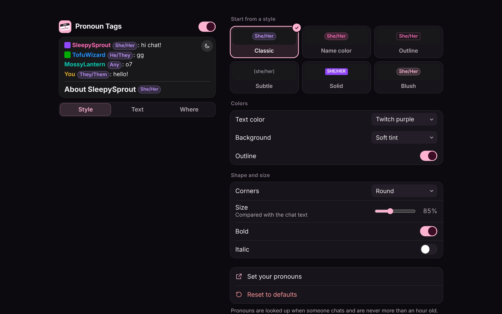
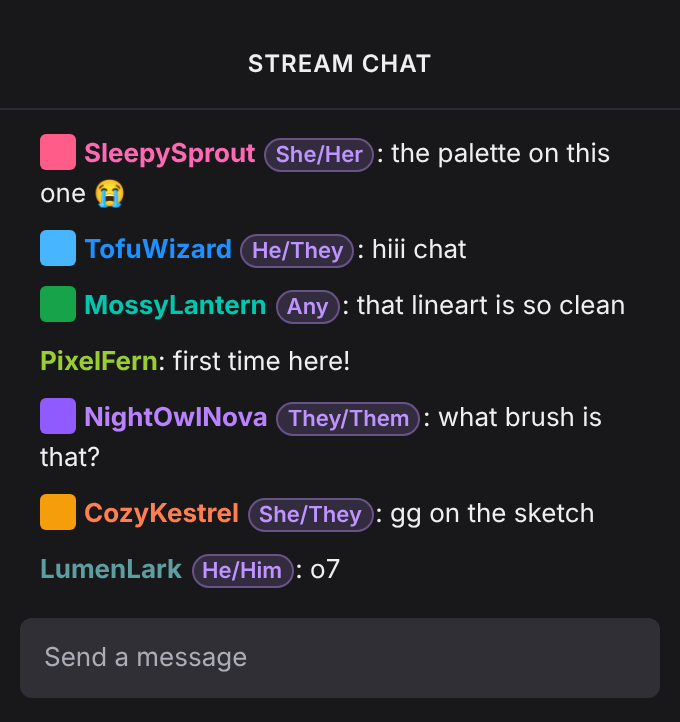
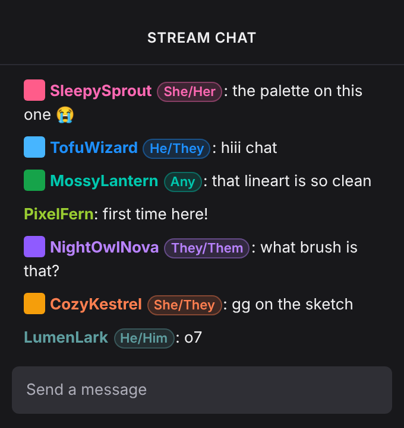
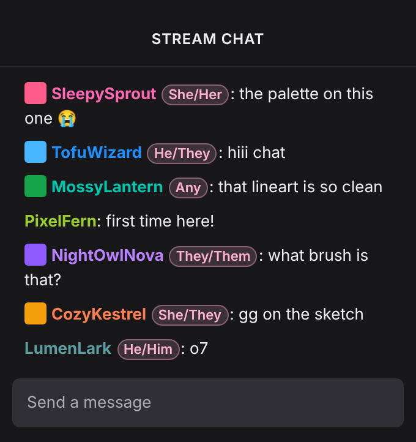
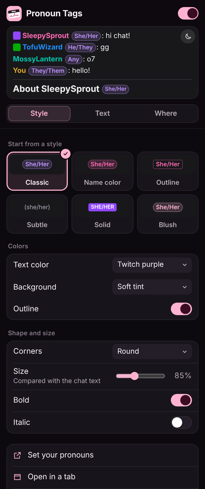
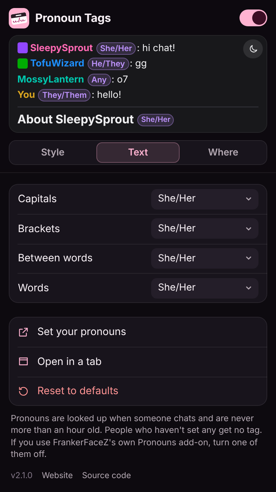
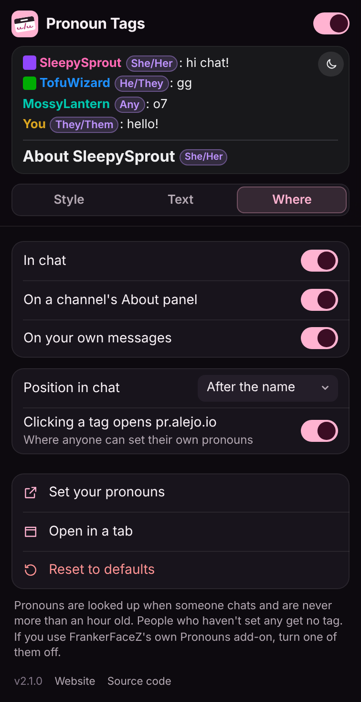

# Pronoun Tags for Twitch

Shows people's pronouns from [pr.alejo.io](https://pr.alejo.io) next to their names in Twitch chat, in a style you choose.



**Website:** [pronouns.sinist3r.lol](https://pronouns.sinist3r.lol)

## Install

| Browser | Get it from |
|---|---|
| Firefox | [Firefox Add-ons](https://addons.mozilla.org/en-GB/firefox/addon/pronoun-tags-for-twitch/) |
| Chrome, Edge, Brave, Opera, Vivaldi, Arc | [Chrome Web Store](https://chromewebstore.google.com/detail/jmfdbkcneimobndcodfjilfdlnclclag) |

Needs Firefox 140+ or a Chromium browser 121+.

## Gallery

| | | |
|:-:|:-:|:-:|
|  |  |  |
| Classic | Name color | Blush |
|  |  |  |
| Style | Text | Where |

## Features

- **Works everywhere on Twitch:** chat, popout chat, mod view, the creator dashboard, VOD replays and a channel's About panel.
- **Works with FrankerFaceZ.** 7TV chat is best effort.
- **Six styles to start from:** Classic, Name color, Outline, Subtle, Solid and Blush.
- **Text:** capitals, brackets, separator, and both words or just the first (She/Her or She).
- **Colors:** Twitch purple, the person's name color, gray or any color. Tint, no background or any color behind it.
- **Shape and size:** round, slightly rounded or square, 60% to 130% of chat text, bold and italic.
- **Where:** chat, About panel and your own messages, each on or off. Before or after the name.
- **Live preview** in Twitch's dark or light theme. Changes apply to open tabs straight away.
- **Languages:** English, Español, Français, Deutsch, Português, Русский and 日本語, following your browser.

People with no pronouns set get no tag. Clicking a tag opens pr.alejo.io so anyone can set their own.

## Settings

Click the Pronoun Tags button in the browser toolbar. **Open in a tab** shows the same settings full size.

Some browsers close the toolbar popup when the color picker opens. If that happens, type the hex code instead or use **Open in a tab**.

### Good to know

- **FrankerFaceZ:** turn off its own Pronouns add-on (FFZ settings → Add-Ons → Pronouns), or you'll see pronouns twice.
- **Rainbark:** has pronoun tags too. While this extension is on, Rainbark leaves pronouns to it.

## Privacy

No servers, no analytics, no ads. To look up pronouns, usernames from chat (and the channel you're viewing) are sent to `api.pronouns.alejo.io`. Settings stay in your browser. Full details in [PRIVACY.md](PRIVACY.md).

Pronoun Tags isn't made by or affiliated with Twitch or pr.alejo.io.

## Development

### Load from source

**Firefox:** go to `about:debugging#/runtime/this-firefox` → **Load Temporary Add-on** → pick `manifest.json`. It's removed when Firefox restarts.

**Chromium:** go to `chrome://extensions` → turn on **Developer mode** → **Load unpacked** → pick this folder.

### Scripts

Run these from the project folder. On Windows, use Git Bash. You'll need Git 2.38+ and Node.js; releases also need the [GitHub CLI](https://cli.github.com).

| Script | What it does |
|---|---|
| `scripts/test.sh` | Checks syntax, JSON, the manifest, text keys and versions. |
| `scripts/package.sh` | Builds the store zip, `dist/pronoun-tags-<version>.zip`. The same zip works for every store. |
| `scripts/bundle.sh` | Zips the project as it is on GitHub, without anything in `.gitignore`. |
| `scripts/commit.sh "Message"` | Runs the checks, then commits every change. |
| `scripts/push.sh` | Checks for merge conflicts, catches up with GitHub if needed, runs the checks and pushes to `main`. |
| `scripts/bump.sh patch` | Raises the version: `patch`, `minor`, `major` or an exact `1.2.3`. |
| `scripts/release.sh` | Tags the version and creates a draft GitHub release with both zips attached. |
| `scripts/publish.sh` | Publishes the draft release. |

A typical release:

```sh
scripts/bump.sh minor
scripts/commit.sh "Version 1.3.0"
scripts/push.sh
scripts/release.sh
scripts/publish.sh
```

### Files

| File | What it does |
|---|---|
| `manifest.json` | Extension manifest for both browsers. |
| `background.js` | All requests to the pronouns API. Shared cache, at most 6 requests at once. |
| `look.js` | Defaults, choices, styles and tag text. Shared by the tags and the settings preview. |
| `content.js` | Finds names on Twitch and adds the tags. Follows setting changes live. |
| `content.css` | Tag styles. Settings arrive as `data-pn-*` attributes and `--pn-*` variables on `<html>`. |
| `popup.html`, `options.html`, `settings.js`, `settings.css` | The settings, in the toolbar popup and in a tab. |
| `_locales/` | All text, per language. |
| `scripts/` | Test, package and release scripts. |

The website lives on the [`gh-pages`](../../tree/gh-pages) branch.

### How lookups work

- **Usernames** come from Twitch's `data-a-user`, FFZ's `data-user`, the "(login)" in a localized name, or the display name, in that order.
- **Your own messages** are found using the login in Twitch's `login` or `twilight-user` cookie. Nothing else is read, stored or sent.
- **Pronoun text:** main + alternate gives She/They. Sets marked `singular` give one word, like Any. Everything else gives She/Her.
- **Cache:** each person is looked up once, for at most an hour. Changing settings never looks anyone up again. "Not found" is cached too. Failures retry after a minute, and a 429 pauses all requests for as long as the API asks.

### Making changes

- **Defaults, choices and styles:** `DEFAULTS`, `CHOICES` and `PRESETS` in `look.js`. New ones also need a name in each `_locales/<language>/messages.json`.
- **How a choice looks:** the matching `[data-pn-…]` rule in `content.css`.
- **Cache length:** `MAX_AGE_MS` in `background.js`.
- **Version:** run `scripts/bump.sh` before each store upload.

Never change the Firefox add-on ID (`pronoun-tags-for-twitch@ame.owo`). Firefox treats a new ID as a new add-on, so existing installs would stop updating.
